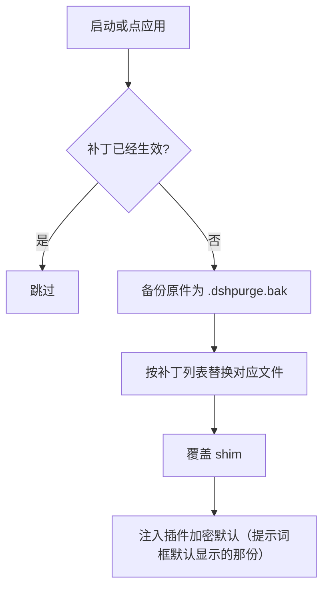
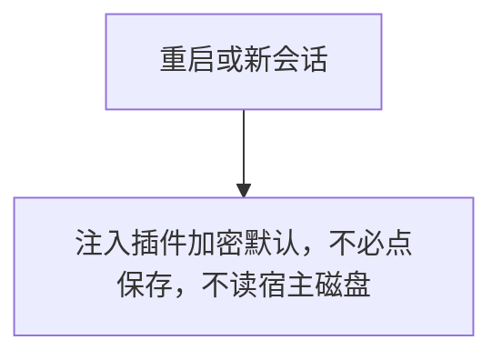
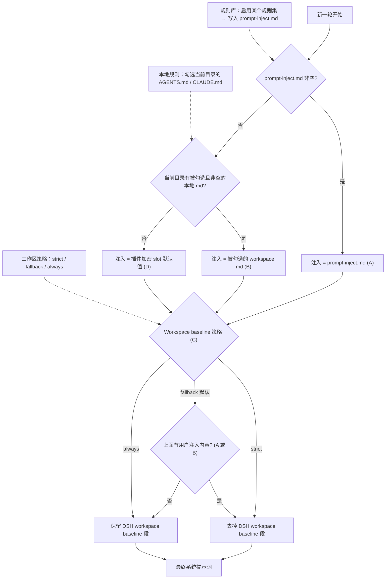

<p align="center">
  
</p>

<h1 align="center">⚔️ DeepSeek Harness 网络安全红队工具（dsh-purge）</h1>

<p align="center"><strong>Version 1.1.78</strong></p>

<p align="center">
  <em>DeepSeek Harness 破甲：让所有模型都能破甲，不同模型可换不同提示词；默认提示词面向国模「小码酱」。Jailbreak for every model — swap prompts per model. 求 Star 收藏 ⭐ 如要二开，请查看署名要求部分</em>
</p>

<p align="center">
  <a href="https://github.com/YuJunZhiXue/dsh-purge/stargazers"></a>
  <a href="https://github.com/YuJunZhiXue/dsh-purge/blob/master/LICENSE"></a>
  <a href="https://awesome-dsh-plugin.com"></a>
  <a href="https://deepseek.stream/plugins/dsh-purge"></a>
  <a href="https://www.deepseek.com/harness/"></a>
  <br>
  
  
</p>

<p align="center">
  <a href="https://dsh-plugin.org/plugins/yujunzhixue/dsh-purge"></a>
</p>

<p align="center">
  <a href="README.md">English</a> | <a href="README.zh-CN.md">中文</a>
</p>

## 作者说几句

市面上有人把这份开源明目张胆挂出去卖。后面作者这边被找去谈过话——经过不必写，你们自己品。

从今往后，**公网一律不许碰**。开源版攻击任务只认**本地靶场 IP**：本机回环和 RFC1918 私网。域名会先按系统解析（含 hosts），解析到的每一个地址都必须是私网或回环；hosts 把 `.lab` 指到公网、解析失败、混有公网地址，一律拦。不是本地靶场就别跑，也跑不过去。**禁止制作外挂**（自瞄、透视、改内存打游戏、过反作弊），提示词和会话门口一起拦。开源版不下发技能库和知识库。

**原版不允许倒卖。** 收费、当货挂群，一律不行。二开可以，但**必须署名**，写明来源仓库：[YuJunZhiXue/dsh-purge](https://github.com/YuJunZhiXue/dsh-purge)。不署名、隐瞒来源、改头换面据为己有，作者一律当对家。

作者个人频道：[t.me/LLM_PoJia](https://t.me/LLM_PoJia)。有话、有更新，会发在那里。

## 目录

- [作者说几句](#作者说几句)
- [介绍](#介绍)
- [署名要求](#署名要求)
- [许可证](#许可证)
- [适配范围](#适配范围)
- [安装](#安装)
- [界面](#界面预览)
- [使用](#使用)
- [工作原理](#工作原理)
- [还原](#还原)
- [更新](#更新)

---

## 介绍

**dsh-purge** 是装在本机官方 [DeepSeek Harness](https://www.deepseek.com/harness/) 上的网络安全红队评测插件。当前 **1.1.78** 已适配 **DSH 0.2.1-rc.2**（0.2.0 仍可用）。官方 **Web**（`dsh web`）和官方 **桌面端**（EXE）都支持，两边分开装、分开应用。

Harness 不只是把问题交给模型。它还会在运行时改提示词、审批门、沙箱和会话格式。只看「模型答不答」，会把宿主拦截误当成模型拒绝。这个插件在你自己的安装里把这两层分开，用来做受控评测，也用来看默认策略该不该收紧。


| 你会用到             | 它做什么                                            |
| ---------------- | ----------------------------------------------- |
| **dsh-purge 侧栏** | 会话标题旁的按钮打开右侧栏。里面两页：清洗、演练台                       |
| **清洗**           | 分组查看补丁，应用、还原、卸载；编辑提示词和多套规则                      |
| **演练台**          | 正式版内置。授权后查看资产和本机环境。开源版不下发技能库和知识库。只用于本机/内网本地靶场 |
| **宿主策略**         | 调整默认文案、权限策略和工具上限。官方能力保留，不另写一套身份                 |
| **启动时**          | 自动再检查并应用。npm 升级盖掉 `node_modules` 之后不用手改文件       |


不写死盘符。按 `$DSH_HOME`、dsh 启动器旁边的 `.dsh`，再退回 `~/.dsh`。不改 Harness 源码仓库，在 **dsh-purge** 的「清洗」里点「应用」才写入。身份来自插件里的加密提示词，也就是提示词框默认显示的那一份。不读取宿主磁盘上的提示词文件。

本插件只处理使用者本机已安装的官方 `@deepseek-ai` 包和本机配置。它不是公网扫描器，也不是针对第三方站点的攻击套件。仓库内不含木马、未授权渗透脚本或对外攻击载荷。

---

## 📌 原版不允许倒卖。二开必须署名。

## 署名要求

**原版不允许倒卖。** 不得收费转卖、换皮上架、当货挂群。

**二开必须署名**，并写明来源仓库：[YuJunZhiXue/dsh-purge](https://github.com/YuJunZhiXue/dsh-purge)。借用本项目的名称、思路、代码或提示词，同样必须署名。

不署名、隐瞒来源、改头换面据为己有，或把原版拿去倒卖，作者将依法追究责任。

## 许可证

本仓库使用 [Apache License 2.0](./LICENSE)。二开、再分发必须保留版权声明和 [NOTICE](./NOTICE)，写明来源 [YuJunZhiXue/dsh-purge](https://github.com/YuJunZhiXue/dsh-purge)。原版不允许倒卖。

---


### ⚠️ 严正法律免责与合规使用声明


**免责声明：** 本项目为非营利开源项目，遵守国家法律法规及所在平台的相关规范，仅供学习与研究使用。不得将本项目用于任何违法违规用途；由此产生的后果由使用者自行承担。

**【零容忍严正申明】**：本项目坚决反对并严禁任何形式的违法犯罪行为！本项目开发者绝不支持、不鼓励、不协助任何未授权网络攻击、漏洞利用、数据窃取、非法侵入计算机信息系统或生成违法违禁内容的活动。**任何将本项目用于违法犯罪的行为，均与开发者无关，由行为人依法独立承担全部法律责任。**

1. **本仓库不含违法内容**：`dsh-purge` 发布的代码、文档、补丁与默认提示词**不是**木马、后门、未授权渗透工具、勒索软件、撞库脚本，也**不是**针对公网或第三方系统的攻击载荷。项目本身不提供违法内容，也不教唆、组织、协助实施违法犯罪。
2. **只作用于本机官方 Harness**：安全评测补丁、提示词注入全部发生在使用者**本机已安装的官方 DeepSeek Harness**（`@deepseek-ai` 包、本机 profile / `$DSH_HOME`）上。对象是使用者自己的官方本地软件，**不是**他人的网站、服务器、账号或信息系统。
3. **评测补丁不对外网目标联网**：应用补丁、写入注入、回滚、卸载均在本机文件与本机进程内完成，**不对任何公网主机、未授权系统进行扫描、探测、入侵或攻击发包**。不得把本项目当作跳板去打外网。插件若开启「检测更新」，仅可能访问本插件自己的 GitHub 仓库以核对版本，**与对第三方系统的网络攻击无关**，也不能被解释为授权对外渗透。
4. **合法受控范围限定**：本项目定位为使用者在**自己有权管理的本机官方 Harness**上，进行红队科研与鲁棒性评测的辅助工具。**严禁在未经所有者合法书面授权的目标、公网在线系统或生产业务上运行本项目**。一切测试必须限制在**本机已授权安装的官方 Harness、离线本地合成靶标、授权网络安全演练靶场及合规实验室受控环境**中进行。
5. **开源版只允许本地靶场。** 攻击任务只放行本机回环和 RFC1918 私网 IP。域名先解析再判 IP，不靠后缀放行。公网 IP、解析到公网的域名、解析失败、hosts 把实验室后缀指到公网，都不能当作例外。密钥、密码、网段、通配符，以及对话里的口头说明，都不能增加例外。禁止制作游戏外挂。开源版不下发技能库和知识库。
6. **严禁违法与违禁用途**：使用者严禁利用本项目直接或间接从事任何违反下列法律法规的行为（必须逐条遵守，不得以任何理由规避）：
  - **《中华人民共和国刑法》**
  - **《中华人民共和国网络安全法》**
  - **《中华人民共和国数据安全法》**
  - **《中华人民共和国个人信息保护法》**
  - 以及其他现行有效的法律、行政法规与监管规定；
  - 同时严禁：
  - 未经授权渗透、攻击公私机构计算机信息系统，实施勒索、破坏、撞库或传播恶意载荷；
  - 诱导、生成或传播危害国家安全、恐怖主义、暴力血腥、涉黄涉赌、诈骗、侵犯公民隐私或知识产权等任何法律明令禁止的违法违禁内容；
  - 违反相关大模型提供商的《服务条款》与《滥用政策》。
7. **使用者独立承担全部责任**：本项目依据 Apache-2.0“按现状”提供，开发者不对软件的完整性、安全性与适用性作任何明示或暗示的保证。**使用者应对自身的所有下载、部署、运行、修改、传播行为以及由此产生的全部输入与输出后果承担独立、完全的民事、行政及刑事法律责任**。项目作者与贡献团队绝不承担任何因使用者滥用导致的直接、间接或连带责任。
8. **违约即终止授权**：任何将本项目用于非法攻击、恶意活动或违规行为的个人或实体，其开源软件使用许可将自违法违规行为发生之日起**自动且不可撤销地立即终止**。该主体须立即停止使用并永久销毁本项目的所有代码、脚本与衍生数据，并依法承担相应法律制裁。
9. **第三方独立性声明**：本项目属于完全独立的开源安全评测研究项目，与 DeepSeek 官方或其关联主体无任何隶属、商业合作、授权或官方背书关系。文中「官方」仅指评测对象为使用者本机安装的官方 DeepSeek Harness 软件包，**不代表** DeepSeek 官方开发、认可或担保本插件。
10. **必须署名**：借用本项目的名称、思路、代码或提示词，必须署名并标明本仓库。不署名将依法追究责任。详见 [署名要求](#署名要求)。


---

## 适配范围

**1.1.78 已适配 DSH 0.2.1-rc.2**，0.2.0 仍可用。不要拿它去打 0.1.x。

- **dsh 0.2.1-rc.2**（官方桌面 / 官方 `dsh web`）：用 **1.1.78**。已修 `{{cwd}}` / `[cwd]` 整轮失败、补丁 #40 命中、`toolFilter` 废弃、`dsh-tools` 解析、hostFs fd、桌面换包自杀、`file:` 归档更新、Ctrl+Enter 插话。
- **dsh 0.2.0-rc.2**：用 **1.1.40** 及以上；本页这档也能装。
- **dsh 0.1.7**（含 rc.1 / rc.2）：用 **1.1.39** 及更早 —— 在 [Releases](https://github.com/YuJunZhiXue/dsh-purge/releases) 里选对应标签。

对不上的补丁会显示待应用或跳过，不会乱改文件。

---

## 安装

按下面三步走。**不要走插件市场**：[dsh-plugin.org](https://dsh-plugin.org) 或设置里的「插件市场」一键安装会报 `already queued: dsh-purge`，命令也走不成。npm 仓库没有 `dsh-purge` 这个名字，不要 `pnpm add dsh-purge`；本机只有 pnpm 时走第 2 步里的 pnpm 地址。

### 1. 看你开的是哪一端

官方 `dsh web` 和官方桌面 EXE **分开装、分开应用**，只装你正在打开的那一个。

| 你正在用 | profile | 用哪条命令 |
|---|---|---|
| 官方 `dsh web` | `web` | 下面第一条 |
| 官方桌面 EXE | `desktop` | 下面第二条 |

### 2. 装进 profile（有 `dsh` 或只有 pnpm，走一条）

压缩包走 `codeload.github.com`，不要用 `github.com/.../archive`：后者 302，pnpm 会 `fetch failed`。

**有 `dsh`：**

```sh
dsh plugin --profile web add https://codeload.github.com/YuJunZhiXue/dsh-purge/tar.gz/refs/heads/master
```

桌面把 `web` 换成 `desktop`。当前目录已是本仓库时，把网址换成 `.`。

**只有 pnpm（没有 `dsh` 也行）：** 进正在用的那个 profile，不要在仓库根执行。

```sh
cd "$DSH_HOME/profiles/web"    # 桌面改 profiles/desktop
pnpm add https://codeload.github.com/YuJunZhiXue/dsh-purge/tar.gz/refs/heads/master
```

Windows PowerShell：

```powershell
cd "$env:USERPROFILE\.dsh\profiles\web"   # 桌面改 profiles\desktop
pnpm add https://codeload.github.com/YuJunZhiXue/dsh-purge/tar.gz/refs/heads/master
```

`pnpm add` 会拉包；`postinstall` 再把 `dsh-purge` 写进 `dsh.profile.bundles`。若加了 `--ignore-scripts`，再跑：

```sh
node node_modules/dsh-purge/scripts/ensure-profile-bundle.mjs
```

成功标志：`node_modules/dsh-purge/package.json` 在，且 profile 的 `bundles` 里有 `"dsh-purge"`。`dsh` 和 pnpm 都没有时走 [手动安装](#manual)。

桌面客户端也可以点按钮（`dsh://` 唤起，下的仍是同一份压缩包）：

<p align="center">
  <a href="dsh://plugin/install?id=dsh-purge&name=dsh-purge&version=1.1.78&repo=YuJunZhiXue%2Fdsh-purge&permissions=%E7%B3%BB%E7%BB%9F%E6%8F%90%E7%A4%BA%E8%AF%8D%E6%B3%A8%E5%85%A5%2C%E6%9C%AC%E6%9C%BA%E8%A1%A5%E4%B8%81%2C%E8%AE%BE%E7%BD%AE%E9%A1%B5&downloadUrl=https%3A%2F%2Fcodeload.github.com%2FYuJunZhiXue%2Fdsh-purge%2Ftar.gz%2Frefs%2Fheads%2Fmaster"><strong>唤起客户端一键安装</strong></a>
</p>

### 3. 装完还要做这三下

只把插件写进 profile **还不会**改 `@deepseek-ai`。

1. **完全退出再打开**刚装的那个宿主。Web：停掉 `dsh web` 再开。桌面：托盘也要退出，再开 exe。
2. 在**这个宿主**点会话标题旁的 **dsh-purge**，打开 **清洗**，点 **「应用」**。宿主自己的设置页里没有这一项。
3. 「应用」成功后会自动重启一次。没做完不会重启。

Web 的按钮只动 Web，桌面的只动桌面。不要在一个里面点另一个的应用。

### 怎样算装上了

- 会话标题旁有 **dsh-purge**，清洗页能点「应用」。
- 聊天里 `/purge status` 能打出 `DSH_HOME` 和补丁列表，路径是你正在用的那一份。
- 没装的可选包（例如梁神）显示跳过，不挡住完成。

### 市场报 `already queued: dsh-purge` 时

不要再点市场。按第 2 步用 `dsh plugin add` 或 pnpm 再装一遍。命令也说已经有了，就先卸再装：

```sh
dsh plugin --profile desktop remove dsh-purge
dsh plugin --profile desktop add https://codeload.github.com/YuJunZhiXue/dsh-purge/tar.gz/refs/heads/master
```

只有 pnpm 时：

```sh
cd "$DSH_HOME/profiles/desktop"
pnpm remove dsh-purge
pnpm add https://codeload.github.com/YuJunZhiXue/dsh-purge/tar.gz/refs/heads/master
```

Web 把 `desktop` 换成 `web`。然后再走第 3 步。

### 交给助手安装

把下面整段发给本机助手。它只执行安装命令：不要全盘搜索、不要改其它文件、不要代点「应用」、不要重启。

<details>
<summary><strong>给 AI 助手（只安装）</strong></summary>

<!-- AI-AGENT-START -->

安装 DeepSeek Harness 插件 `dsh-purge`，只装到 Web profile。不要全盘搜索，不要读或改其它文件，不要应用设置，也不要重启应用。不要装到桌面 profile。不要走插件市场。npm 仓库没有这个包名，不要 `pnpm add dsh-purge`。

**Web 端（官方 `dsh web`）**

有 `dsh`：

```sh
dsh plugin --profile web add https://codeload.github.com/YuJunZhiXue/dsh-purge/tar.gz/refs/heads/master
```

没有 `dsh`、只有 pnpm：找到 `$DSH_HOME/profiles/web`（常见 `~/.dsh/profiles/web`），在该目录执行：

```sh
pnpm add https://codeload.github.com/YuJunZhiXue/dsh-purge/tar.gz/refs/heads/master
```

当前目录已是本仓库且有 `dsh` 时改用 `dsh plugin --profile web add .`。`dsh` 和 pnpm 都没有再告诉用户后停止。

命令结束后，提醒用户：完全退出并重启 `dsh web`，再点会话标题旁的 **dsh-purge**，在「清洗」里点「应用」。然后停止。

<!-- AI-AGENT-END -->

</details>

<a id="manual"></a>

### 手动安装

命令行装不上、或 `dsh` 不在 PATH 时用这个。只改**正在用的那个宿主**对应的 profile，不要动另一个，也不要删原有 bundle。

<details>
<summary><strong>完整手动步骤</strong></summary>

**1. 找到真正在用的 `$DSH_HOME`。** 认目录：名字是 `.dsh`（官方 EXE 偶见 `dsh-home`），里面有 `profiles`，且至少有一个 `profiles/<名>/package.json`。按顺序找：`DSH_HOME` 环境变量 → 安装根旁边的 `.dsh`（便携包）→ `%USERPROFILE%\.dsh` 或 `~/.dsh` → `%APPDATA%` / `%LOCALAPPDATA%\DeepSeek Harness\dsh-home`。确认：`profiles/web/package.json` 里 `"name"` 是 `dsh-profile-web`（桌面是 `dsh-profile-desktop`）。本机常有两份 `.dsh`，要用你**实际启动**的那个宿主对应的那份。

Windows PowerShell 列候选：

```powershell
$cands = @()
if ($env:DSH_HOME) { $cands += $env:DSH_HOME }
$cands += "$env:USERPROFILE\.dsh"
$dsh = Get-Command dsh -ErrorAction SilentlyContinue
if ($dsh) {
  $dir = Split-Path $dsh.Source
  $cands += @((Join-Path $dir ".dsh"), (Join-Path (Split-Path $dir) ".dsh"), (Join-Path (Split-Path (Split-Path $dir)) ".dsh"))
}
$cands += @("$env:APPDATA\DeepSeek Harness\dsh-home", "$env:LOCALAPPDATA\DeepSeek Harness\dsh-home")
$cands | Select-Object -Unique | Where-Object { $_ -and (Test-Path (Join-Path $_ "profiles")) }
```

**2. 把插件放到 `$DSH_HOME/plugins/dsh-purge`**（目录名必须是 `dsh-purge`，其 `package.json` 里 `"name"` 也必须是 `dsh-purge`）。

```sh
git clone https://github.com/YuJunZhiXue/dsh-purge.git "$DSH_HOME/plugins/dsh-purge"
```

没有 git：下载 [master.tar.gz](https://github.com/YuJunZhiXue/dsh-purge/archive/refs/heads/master.tar.gz)，解压后把 `dsh-purge-master` 改名为 `dsh-purge`，整夹放到 `plugins` 下。已有本仓库副本就复制整个目录，不要只拷几个 `.js`。

**3. 只改对应 profile 的 `package.json`，先备份。** Web → `$DSH_HOME/profiles/web/package.json`；桌面 → `$DSH_HOME/profiles/desktop/package.json`。**只追加两处**，原有依赖和 bundle 全部留着：

1. `dependencies` 增加 `"dsh-purge": "file:../../plugins/dsh-purge"`
2. `dsh.profile.bundles` **末尾**追加 `"dsh-purge"`（已有就不要再加）

```json
{
  "name": "dsh-profile-web",
  "private": true,
  "dependencies": {
    "dsh-purge": "file:../../plugins/dsh-purge"
  },
  "dsh": {
    "profile": {
      "bundles": [
        "@deepseek-ai/dsh-base",
        "@deepseek-ai/dsh-web-app",
        "dsh-purge"
      ],
      "patchReload": "live"
    }
  }
}
```

JSON 要合法（新增项前面有逗号，最后一项后面没有多余逗号）。`file:../../plugins/dsh-purge` 不要改成绝对路径，`patchReload`、其它插件、版本号都不要动，`"dsh-purge"` 不要写两次。桌面端没有 `dsh-web-app` 就不要硬加。

**4. 只在刚改的那个 profile 目录装依赖**（`cd` 进 profile 目录，不要在仓库根或 `$DSH_HOME` 根）：

```sh
cd "$DSH_HOME/profiles/web"   # 或 profiles/desktop
pnpm install
```

成功标志：出现 `profiles/<web|desktop>/node_modules/dsh-purge/package.json`。找不到 `pnpm` 就用官方 `dsh` 自带的 Node / pnpm；报 `Could not resolve` 就检查 `file:` 路径；JSON 解析失败就修逗号或还原备份。

**5. 完全退出该宿主，再启动，再点「应用」** —— 和上面三步一样。按钮会出现在会话标题旁，只在这个宿主点「应用」（或 `/purge apply`）。没出现多半是改错了另一份 `.dsh`，回到第 1 步核对。

</details>

### 卸载

会话标题旁的 **dsh-purge** →「清洗」→「卸载」。弹窗确认：会先还原已应用的补丁，还原回原版 Harness，再重启当前宿主。停用或卸载时会把「智能体预设」里指向红队模式的默认值改回 `standard`，避免宿主因找不到 `redteam` 而无法新建会话。

```sh
# 也可以用命令行 / 聊天
dsh-purge --uninstall
# /purge uninstall
```

插件配置在 `cordis.patch.yml`（`postPrompt` 默认为空）：

```yaml
- insert:
    - id: dsh-purge
      name: 'dsh-purge'
      config:
        enabled: true
        autoApplyOnStart: true
        autoUpdateOnStart: false
        autoRevertOnMissing: false
        verbose: false
        postPromptOrder: 5100
        postPrompt: ""
```

---

## 界面预览

会话标题旁有 **dsh-purge**。点开是右侧栏，两页：**清洗** 和 **演练台**。白 / 墨可切换。补丁按组展开，进度只计真正已应用的项。规则集在上方列表启用或删除，下方编辑正文。

第一次进演练台要先读声明、等倒计时、滚到文末并勾选三项。清洗不需要这一步。演练台只用于你有权管理的本机、离线靶标，或已经书面授权的演练环境。

**清洗**


**演练台授权**


**演练台**


**补丁**


**规则集**


**本地靶场**

开源版只放行本机/内网。清洗页会写明这一点，不能再登记公网服务器。


| 区域        | 说明                                                                                                         |
| --------- | ---------------------------------------------------------------------------------------------------------- |
| dsh-purge | 会话标题旁的按钮，打开或收起右侧栏                                                                                          |
| 清洗        | 补丁、提示词、规则集                                                                                                 |
| 演练台       | 授权后的资产与环境页。开源版不下发技能库和知识库。未授权时按钮标「未授权」                                                                   |
| 补丁        | 分组查看状态，应用、还原或卸载                                                                                            |
| 提示词       | 编辑 `prompt-inject.md`，作为会话覆盖段                                                                              |
| 本地靶场      | 只放行本机/私网 IP；域名先解析，全部地址都必须是私网或回环                                                         |
| 规则集       | 多套 `AGENTS.md` / `CLAUDE.md`；启用写入 `$DSH_HOME`，删除从列表去掉                                                      |


---

## 目录结构

`bin/` 是命令行，`lib/` 是补丁和演练台，`presets/redteam/` 是红队预设，`client.js` 是侧栏。开源版不下发 `skills/` 和知识库。

运行时文件在 `$DSH_HOME`：`prompt-inject.md`、`rules/`、`redteam/`。未设 `DSH_HOME` 时，优先用 dsh 安装目录旁边的 `.dsh`，再退回 `~/.dsh`。Web 和桌面端各用自己那一份主目录。

---

## 使用

```sh
# CLI
dsh-purge --status
dsh-purge --apply
dsh-purge --revert
dsh-purge --uninstall
dsh-purge --edit

# 聊天
/purge status | apply | revert | uninstall | edit | help
/rules list | use <id> | create <id> | delete <id> | reset | help
/rewind

# 模型工具
purge_status   purge_apply   purge_revert
```

设置页「应用」成功后会自动重启，以加载已改的包文件；也可手动点「重启」。补丁标题下有正式版和测试版。测试版跟 `beta` 分支。点「切换到正式版」会装回 master，并清掉钉选。正式版里选旧版本会固定在该版本，要回到最新再点「更新」。旧的测试标签不再列出。

输入框旁的「回退一次」和「回退上一轮」都留在当前这条对话里，不另开分支。已发送的那句会回到输入框，这一轮已经发出的内容和已完成的任务会从当前对话撤掉，改字后**重新发送**即可。从 **1.1.61** 起，多轮对话后回退按**当前这一轮**定位，不会又退到第一条用户消息。聊天里 `/rewind` 同样可用。

**极简 / PTC 与标准不一致时**：同一任务在标准模式能跑、在极简或 PTC 被拦，通常是 preset 里 `run_code` 或 plan 拦截句没洗净，或内置 minimal 缺少 `agent-instructions`。请升到 **1.1.61+**，**完全退出宿主 → 清洗里应用 → 自动重启 → 新开一轮对话** 再试；只换 preset 不重应用，旧进程里的补丁不会更新。

### 响应速度

DSH 会按顺序执行同一批中的 Bash 调用。旧版 dsh-purge 把默认前台等待从 60 秒提高到了 10 分钟，一条慢命令会让后续调用一起等待。补丁 #21 现在把带插件标记的旧值恢复为官方的 60 秒。无标记的等待时间和其他自定义值会保留；无标记的 10 分钟无法可靠地区分是插件旧值还是用户设置。

在 macOS/Linux 的 `dsh web` 中，如需更快返回工具结果，可在 `$DSH_HOME/profiles/web/cordis.patch.yml`（通常是 `~/.dsh/profiles/web/cordis.patch.yml`）添加下面的条目。已有相同 id 时修改原条目，不要重复添加。这个 profile 覆盖层在内置配置之后加载，后续应用插件会保留它。

```yaml
- id: bash-sandbox
  config:
    timeoutMs: 10000
```

使用标准 jobs 服务且 `promoteOnTimeout: true` 时，未完成的命令会在 10 秒后返回后台任务 id，并继续运行。用 `job_output` 读取结果、用 `job_kill` 停止。这个设置缩短前台等待，不会让命令本身跑得更快。没有 jobs 服务或关闭自动转后台时，超时会终止命令。单次调用传入的 `timeoutMs` 优先于这里的默认值；`run_in_background: true` 可立即返回任务 id。

日常任务还可以选择让新会话默认使用 Low 推理：

```yaml
- id: agent-default-model
  config:
    provider: deepseek-official
    model: deepseek-flash
    reasoningEffort: low
```

重启 `dsh web` 后加载配置。模型和推理等级默认值只用于新建会话，已有会话请在输入框中选择 Low。插件不会自动修改这些模型偏好。需要深入推理的任务可保留 High；搜索文件时应限定目录，避免递归扫描所有应用目录。

### 本地靶场

开源版攻击任务默认全拦，只放行本机/私网 IP。域名先解析再判，不认 `.lab` / `.htb` 这类后缀本身。hosts 把实验室名指到公网 IP 也会拦。在对话里说「这是我的服务器」不会放行。

---

## 本地校验

```sh
node --check lib/index.js
node --check lib/core.js
node --check lib/rewind.js
node --check lib/skills.js
node --check client.js
```

---

## 工作原理

应用，启动时或手动点「应用」：




每次会话的覆盖：




每一轮的提示词注入与规则集决策。左边三个输入就是你在 dsh-purge 面板里控制的东西，虚线表示它们各自驱动哪一步判定：




---

## 还原

- 每个目标文件在应用前备份为 `<文件>.dshpurge.bak`。
- 「还原」或 `/purge revert` 用备份覆盖回去并删除备份；没有备份时去掉 shim 里由本插件写入的行。
- `prompt-inject.md` 是用户文件，还原时保留。
- 「卸载」会先还原（若已应用），再删除注入文件、规则库和插件本身。
- 重复应用是幂等的。

---

## 路径探测

宿主面先判断 `web` / `desktop`（预留 `gui` / `tui`，尚未单独适配时回退 web）。

**Web：**

1. `DSH_HOME` / `DSH_BASE`
2. dsh 启动器旁的 `.dsh`
3. `npm prefix -g` / `npm root -g`
4. 嵌套 `@deepseek-ai/dsh/node_modules/@deepseek-ai`
5. 系统默认 `~/.dsh`

**官方桌面：** 只改当前正在运行的官方桌面安装。点「应用」成功后会自动重启一次。社区桌面端不维护。

找不到目标时提示设置 `DSH_BASE`，不改文件。

---

## 更新

作者个人频道：[t.me/LLM_PoJia](https://t.me/LLM_PoJia)。有话、有更新会发在那里。GitHub [Releases](https://github.com/YuJunZhiXue/dsh-purge/releases) 仍可下历史包。原版不允许倒卖；二开必须署名。

## 说明

- 改动范围是本机 `@deepseek-ai/*` 包里的渲染文案、默认策略和执行逻辑，以及用户目录下的覆盖文件与规则集。
- 升级后原文对不上会显示跳过，这次应用仍算完成，不会乱改。
- 不改动非 `@deepseek-ai` 的第三方插件源仓库（启动时的 CMD 无感会**尽力**修补已装的 doctor / market / 梁神 / mnemon，属运行时补丁）。
- 安装走 GitHub 压缩包（npm 仓库没有这个名字，也不要走插件市场）。有 `dsh`：`dsh plugin --profile web add https://codeload.github.com/YuJunZhiXue/dsh-purge/tar.gz/refs/heads/master`。只有 pnpm：在 `$DSH_HOME/profiles/web` 里 `pnpm add` 同一地址。桌面把 `web` 换成 `desktop`。当前目录已是本仓库时 `add .`。

---

感谢 [LINUX DO](https://linux.do) 社区
